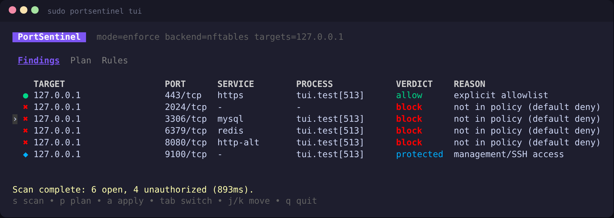
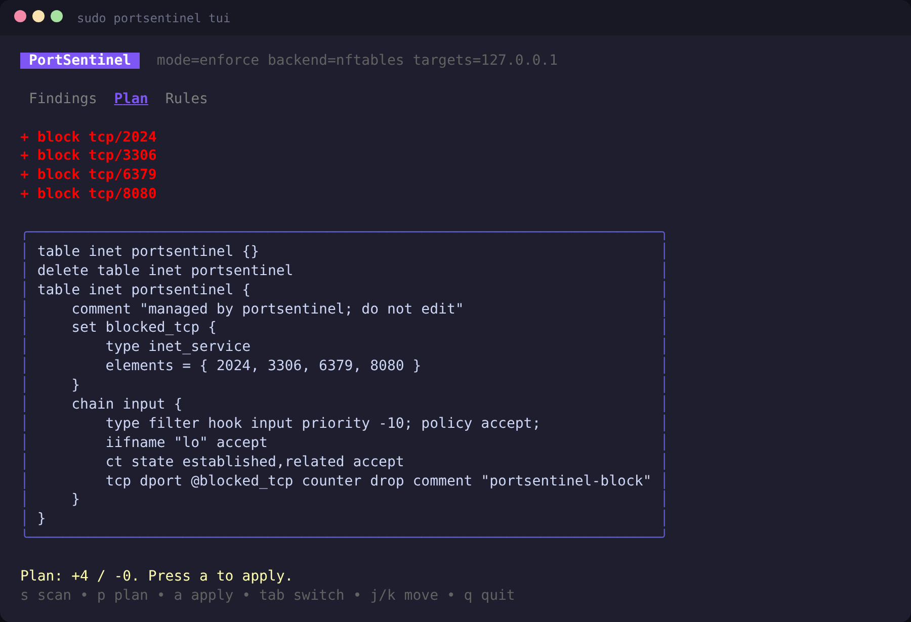
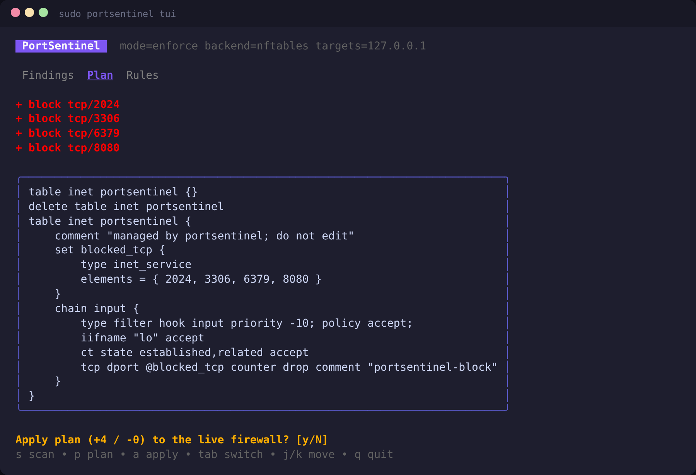
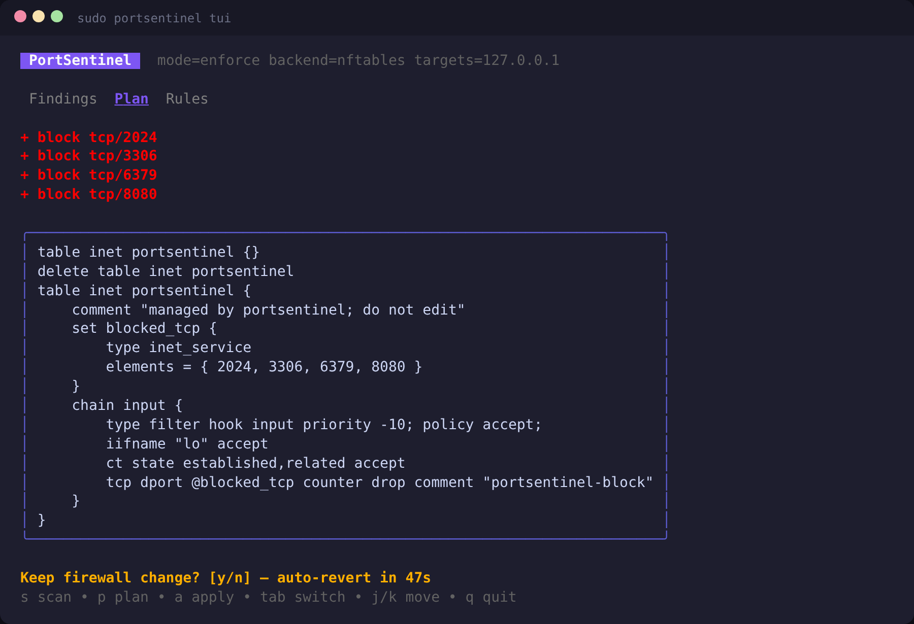

# PortSentinel

[](https://github.com/bakhod1r/portsentinel/actions/workflows/ci.yml) [](https://github.com/bakhod1r/portsentinel/releases) [](https://bakhod1r.github.io/portsentinel/) [](LICENSE)

External port exposure detection and automated nftables enforcement for Linux servers, written in Go.

## Screenshots

| Findings | Plan |
|---|---|
|  |  |
| **Apply confirmation** | **Timed keep-or-revert** |
|  |  |

Regenerate: `PS_SCREENSHOT_DIR=out go test ./internal/tui -run Screenshots` (dumps ANSI frames).

## Install

Download a binary from [Releases](https://github.com/bakhod1r/portsentinel/releases), or build:

## Build

```sh
make build && sudo make install   # or: make dist
```

## Quick start

```sh
sudo ./portsentinel init                 # writes /etc/portsentinel/config.yaml (mode: audit)
sudo ./portsentinel doctor               # check root, nft, /proc, targets
sudo ./portsentinel audit                # table of open ports + policy verdicts (exit 2 on violations)
sudo ./portsentinel plan                 # show the nftables ruleset that would be loaded
sudo ./portsentinel tui                  # interactive dashboard
# set `mode: enforce` in the config, then:
sudo ./portsentinel apply                # validate → apply → verify → confirm-or-auto-revert
sudo ./portsentinel rollback             # restore previous managed state
```

### TUI keys
`s` scan · `p` plan · `a` apply (enforce mode, asks y/N, then timed keep/revert) · `tab` switch Findings/Plan/Rules · `j/k` move · `q` quit

## Safety model
- All rules live in a dedicated `inet portsentinel` table; other tables are never touched, and the ruleset is never flushed.
- Scripts are checked with `nft -c` before an atomic `nft -f`.
- SSH port, `management_ports`, and the port of the current `SSH_CONNECTION` are never blocked.
- Each apply writes a pending marker; an interrupted run is rolled back on the next start.
- Every action is appended to a JSON Lines audit log.
- For true external verification, run `portsentinel verify` from a second host with the server as target.

## Example config
```yaml
targets: [203.0.113.10, example.com]
mode: audit            # audit | dry-run | enforce | monitor
backend: nftables
rollback_timeout: 60s
scan:
  ports: "1-1024,3306,5432,6379,8080"
  timeout: 800ms
  concurrency: 256
  interval: 15m
  banner: true
policy:
  ssh_port: 22
  allowed_tcp: [80, 443]
  allowed_ranges: [{from: 60000, to: 60010}]
  management_ports: [9100]
  exceptions:
    - {port: 8080, reason: "demo", expires: 2026-12-31T00:00:00Z}
```

See [docs/PLAN.md](docs/PLAN.md) for the roadmap. systemd units are in `deploy/`.

## Known issues (v0.1.0)
- `apply` verifies from the same host; that traffic arrives over `lo`, which the managed chain accepts, so verification fails and the change is auto-reverted. Use `audit`, `plan` and `tui` for now.
